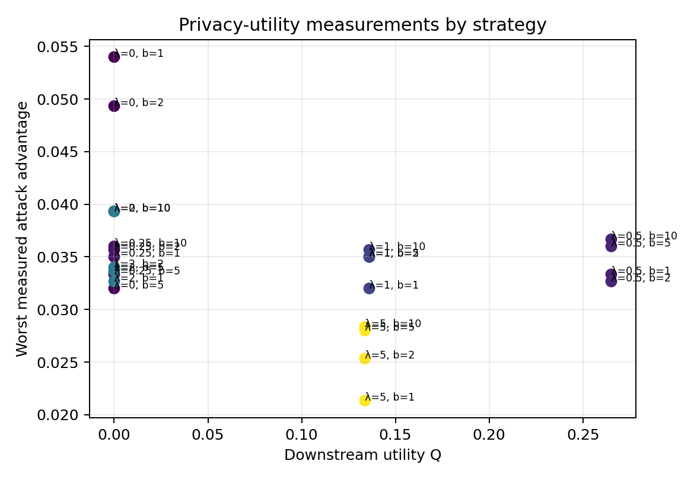
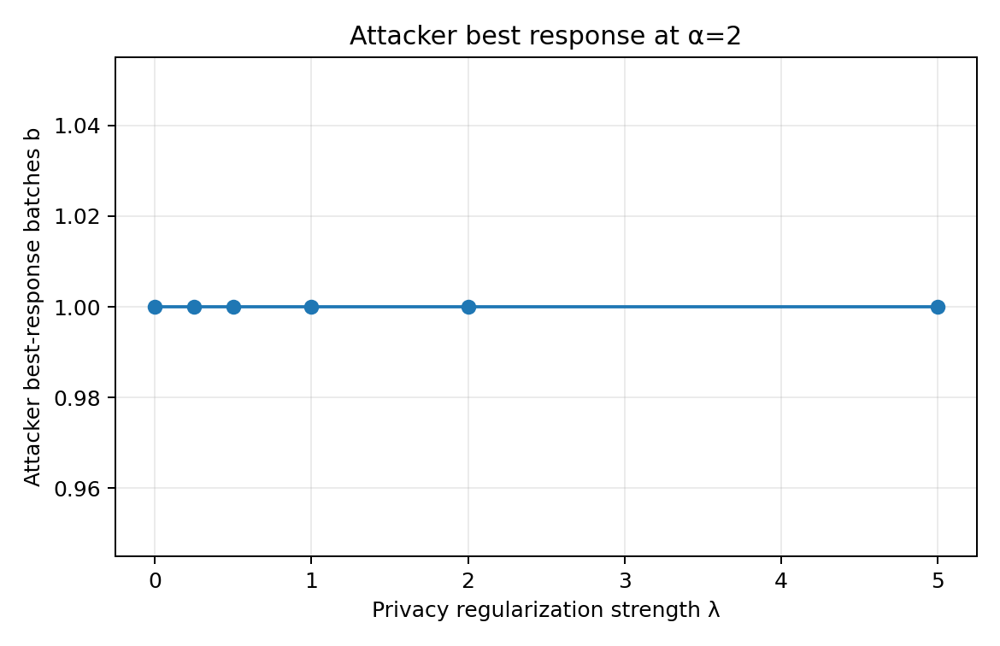
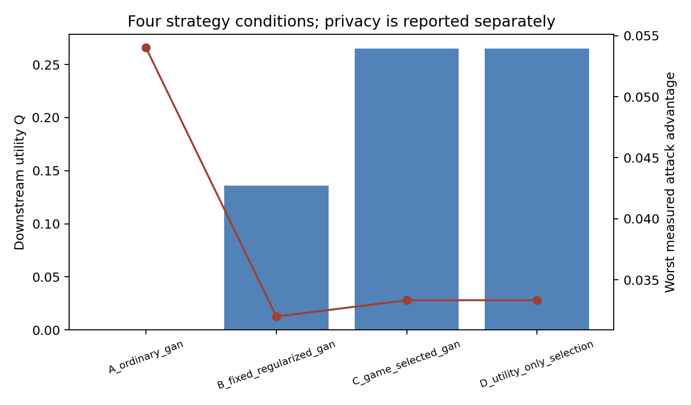

# Game-Theoretic GAN Privacy: Experimental Report

## Study status

This report was regenerated from the saved experiment rows. The recorded run mode is **full**. It contains 3 independent seed(s), 6 lambda values, and 72 successful seed/lambda/budget rows. The reported evidence is limited to the configured seeds, model, data and attacks.

## Research question and contribution

The project studies how a data owner can select a privacy-regularization strength for a tabular GAN when an attacker can query multiple synthetic releases. It evaluates whether a finite-grid Stackelberg strategy adds value over an ordinary GAN, a fixed regularized GAN, and a utility-only strategy choice.

## Model and threat model

The generator and discriminator are compact multilayer perceptrons trained on a train-fitted one-hot/min-max representation. The discriminator minimizes real/fake binary cross-entropy plus λ times the squared difference between mean discriminator scores on GAN members and a separate regularizer-reference set. λ=0 recovers the ordinary GAN loss. The privacy-gap loss and adversarial losses are logged separately. The reference set is used during training and is therefore not used as an untouched membership-attack non-member set.

The evaluation attacker receives independent synthetic release batches. Its baseline scores a candidate by nearest mixed-feature distance to a released row. A shadow-model attacker trains a logistic classifier on release-distance features from disjoint shadow records; the classifier and its threshold are fitted on shadow membership labels, not on target evaluation labels. The evaluation also reports ROC-AUC, maximum ROC TPR-FPR advantage, confidence intervals, and the random baselines (AUC 0.5 and advantage 0). These are empirical attacks and do not establish formal privacy.

## Stackelberg game

The leader is the data owner and chooses λ from the configured finite grid. The follower observes λ and chooses b, the number of independent synthetic release batches. For each candidate λ, the attacker chooses a best response that maximizes `U_A(λ,b) = P(λ,b) - c_A b`, where P is the strongest measured attack advantage and c_A is the configured cost per release batch. The owner then chooses λ that maximizes `U_O(λ,b*(λ)) = Q(λ) - α P(λ,b*(λ)) - C_O(λ)`. Q is synthetic-trained downstream F1 evaluated on held-out real data; the real-trained reference F1 is reported separately. `C_O(λ) = c_O λ/(1+λ)`. Ties resolve to lower b for the attacker and lower λ for the owner. Results are finite-grid Stackelberg solutions, not continuous global equilibria.

## Data and reproducibility

Dataset: UCI Adult, using the configured features `age, education-num, hours-per-week, workclass, education, marital-status, occupation, relationship` and target `income`. Per seed, the disjoint split assigns 60% to GAN members, 10% to regularizer reference, 15% to untouched attack non-members, and 15% to held-out utility evaluation. Encoders are fitted on members only. The recorded experiment configuration is in `results/run_config.json`; raw rows are in `results/raw/experiments.csv` and failures in `results/raw/failures.csv` (0 failed configuration(s)).

## Results by lambda

The following table summarizes the smallest configured attack budget, b=1. Means and sample standard deviations are across independent seeds; standard deviation is undefined for single-seed runs. Attack confidence-interval endpoints are averaged from within-run candidate bootstraps.

```text
 lambda  utility_q  utility_sd  mia_auc  mia_auc_sd  mia_auc_ci_low  mia_auc_ci_high  mia_advantage  mia_advantage_sd  mia_advantage_ci_low  mia_advantage_ci_high  train_seconds
   0.00   0.000000    0.000000 0.519253    0.001469        0.493602         0.542992       0.054000          0.005292              0.029950               0.098658      50.059884
   0.25   0.000000    0.000000 0.507515    0.003952        0.485228         0.530831       0.035000          0.008544              0.018125               0.077050      50.174213
   0.50   0.265120    0.229601 0.505768    0.004061        0.480500         0.528570       0.033333          0.004041              0.014600               0.076400      50.096985
   1.00   0.136039    0.235627 0.503790    0.015747        0.480545         0.525712       0.032000          0.011533              0.014633               0.073542      50.324588
   2.00   0.000000    0.000000 0.505340    0.011025        0.481604         0.529074       0.032667          0.018771              0.014650               0.078717      52.643775
   5.00   0.133765    0.231688 0.502561    0.003355        0.478846         0.525459       0.021333          0.004163              0.011158               0.070817      52.124616
```

## Four strategy conditions

The comparison uses α=2. All conditions are evaluated at the attacker's measured best-response budget. The utility-only condition chooses λ by mean Q without considering attacker payoff.

```text
               condition  lambda  best_budget  utility_q  mia_auc  mia_advantage
          A_ordinary_gan     0.0            1   0.000000 0.519253       0.054000
 B_fixed_regularized_gan     1.0            1   0.136039 0.503790       0.032000
     C_game_selected_gan     0.5            1   0.265120 0.505768       0.033333
D_utility_only_selection     0.5            1   0.265120 0.505768       0.033333
```

## Interpretation of saved measurements

At α=2, the saved runs selected λ=0.5 with best-response budget b=1; utility Q=0.265 and strongest measured attack advantage=0.033. Compared with the ordinary GAN, the fixed regularized condition changed Q by +0.136 and attack advantage by -0.022. These values describe the saved experimental output only.

## Figures







Privacy, utility and runtime remain separate measurements. Aggregated metrics are saved in `results/tables/summary.csv`. The game table stores each λ's attacker best response and owner payoff for every configured α. Sensitivity results vary attacker cost and the available λ grid.

## Limitations and interpretation

The score-gap penalty is a hypothesis about one discriminator signal; it does not guarantee that membership information is removed. The shadow attack uses distance summaries and logistic regression, so other attacks may perform better. Attack confidence intervals describe candidate resampling within a run; between-seed variation is shown separately. The compact GAN and Adult benchmark do not establish safety on other datasets or architectures. No differential privacy guarantee or DP baseline is implemented. If this report comes from a smoke run, its measurements are only pipeline diagnostics.

## Reproduction

From the project directory, install `requirements.txt`, run `python -m src.cli prepare-data`, then `python -m src.cli run-experiments --mode full`, followed by `python -m src.cli analyze`. This regenerates raw rows, aggregates, game solutions, sensitivity tables, comparison tables, figures and this report from the saved outputs.

## References

- Xu et al. (2019), *Modeling Tabular Data using Conditional GAN*, NeurIPS. https://papers.nips.cc/paper/8953-modeling-tabular-data-using-conditional-gan
- Shokri et al. (2017), *Membership Inference Attacks against Machine Learning Models*, IEEE S&P. https://doi.org/10.1109/SP.2017.41
- Hyeong et al. (2022), *An Empirical Study on the Membership Inference Attack against Tabular Data Synthesis Models*. https://arxiv.org/abs/2208.08114
- UCI Machine Learning Repository, Adult dataset, DOI 10.24432/C5XW20. https://archive.ics.uci.edu/dataset/2/adult
